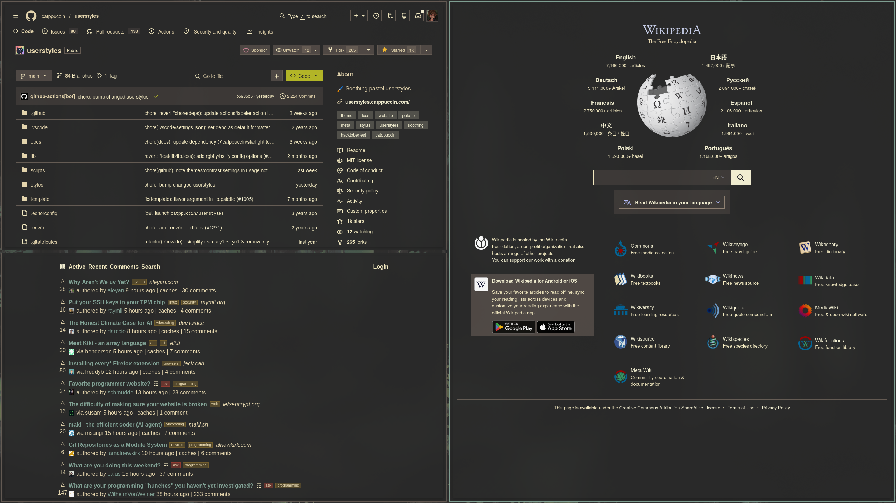

<!-- rumdl-disable MD033 MD041 -->

<div align="center">
  

  # nix-userstyles

  Build Catppuccin userstyles with Nix and use your Base16 palette in Firefox.

  [](https://github.com/adam01110/nix-userstyles)
  <br />
  [](https://nixos.wiki/wiki/Flakes)
  [](https://github.com/catppuccin/userstyles)
  [](https://support.mozilla.org/en-US/kb/contributors-guide-firefox-advanced-customization)

  [Usage](#usage) - [Styles and selectors](#styles-and-selectors) - [Library](#library) - [Development](#development)
</div>

This is a fork of [`knoopx/nix-userstyles`](https://github.com/knoopx/nix-userstyles).
It compiles upstream Catppuccin themes, maps their colors to a Base16 palette,
and produces a CSS file you can use as Firefox's `userContent.css`.

The main style source is [`catppuccin/userstyles`](https://github.com/catppuccin/userstyles).
Discord and Tangled use separate upstream sources. You can add your own site
selectors and append local CSS without editing those themes.

<div align="center">
  
</div>

## Usage

Add the flake to your inputs:

```nix
{
  inputs = {
    nix-userstyles.url = "github:adam01110/nix-userstyles";
  };
}
```

Pass `nix-userstyles` to your Home Manager modules through
`extraSpecialArgs`. Then build a stylesheet for your Firefox profile:

```nix
{
  nix-userstyles,
  pkgs,
  ...
}: let
  system = pkgs.stdenv.hostPlatform.system;
  palette = nix-userstyles.inputs.nix-colors.colorSchemes.gruvbox-dark-medium.palette;
in {
  home.file.".mozilla/firefox/default/chrome/userContent.css".source =
    nix-userstyles.lib.mkUserContent system {
      inherit palette;
      userStyles = [
        "github"
        "reddit"
        "tangled"
        "youtube"
      ];
    };
}
```

Replace `default` in the path with your actual profile directory. You can find
it under `about:profiles`. Set
`toolkit.legacyUserProfileCustomizations.stylesheets` to `true` in `about:config`
and restart Firefox after applying the file.

### Use a Stylix palette

If Stylix already supplies your colors, use them instead of the bundled palette.
In a module with access to `config.lib.stylix.colors`, define `palette` as:

```nix
palette = lib.filterAttrs (name: _: lib.hasPrefix "base0" name) config.lib.stylix.colors;
```

The palette needs `base00` through `base0F` as hexadecimal strings without `#`.
The library derives the extra color slots used by its Catppuccin mapping.

### Append local CSS

Set `extraCss` in the same `mkUserContent` call:

```nix
extraCss = ''
  @-moz-document domain("example.com") {
    body {
      outline: 1px solid red !important;
    }
  }
'';
```

Generated theme declarations get `!important`. Extra CSS is appended afterward
and left unchanged, so add `!important` yourself where needed.

## Styles and selectors

Use names from the upstream `styles/` directory, plus `discord` and `tangled`.
[`lib/testUserStyles.nix`](./lib/testUserStyles.nix) lists the styles included in
the bundled test build, not every style available upstream. Missing Less style
files are skipped, so check the name if a selected style produces no CSS.

Each `userStyles` entry can be a name string or an attribute set:

```nix
userStyles = [
  "github"
  {
    name = "reddit";
    sites = [ ''domain("old.reddit.com")'' ];
  }
  {
    name = "searxng";
    defaultSites = false;
    sites = [ ''domain("search.example.com")'' ];
  }
];
```

| Attribute | Default | Meaning |
| --- | --- | --- |
| `name` | Required | Upstream style name, `discord`, or `tangled` |
| `defaultSites` | `true` | Keep the upstream site selectors |
| `sites` | `[]` | Additional Firefox `@-moz-document` selector fragments |

With `defaultSites = false`, `sites` replaces the default selectors and must
contain at least one entry. Selector fragments are used as written:

```nix
sites = [
  ''domain("example.com")''
  ''url-prefix("https://example.org/app")''
  ''regexp("https://example\\.net/.*")''
];
```

Discord is compiled from [`catppuccin/discord`](https://github.com/catppuccin/discord)
SCSS.

### Tangled

The `tangled` style uses the separate
[Tangled Catppuccin userstyle](https://tangled.org/did:plc:y77gjqopzj4i6l4y7woi6d22).
Its 1.2.0 rewrite targets Tangled's Svelte frontend and no longer supports the
old Go appview.

The build maps the theme's semantic `--color-*` tokens to your Base16 palette.
Those tokens also supply colors to Pierre diff views inside their shadow DOM.
Both light and dark flavor settings use the same supplied palette, rather than
switching between upstream Catppuccin flavors. This uses the existing
`"tangled"` entry in `userStyles`; no separate configuration is needed.

## Library

All helpers take the target `system` first. Their outputs are CSS files, not
directories.

| Call | Result |
| --- | --- |
| `lib.mkUserStyles system palette userStyles` | Compiled, palette-mapped themes with `!important` declarations |
| `lib.withExtraCss system cssFile extraCss` | An existing CSS file with extra CSS appended verbatim |
| `lib.mkUserContent system { palette; userStyles; extraCss = ""; }` | Theme generation and optional extra CSS in one call |

`mkUserContent` uses the same theme output as `mkUserStyles`. It doesn't install
the file or change Firefox settings.

## Development

The package outputs use the bundled test style list and the
`gruvbox-dark-medium` palette:

| Output | Contents |
| --- | --- |
| `packages.<system>.default` | Generated themes |
| `packages.<system>.user-content` | The same themes through `mkUserContent` |
| `packages.<system>.with-extra-css` | Generated themes with sample local CSS |
| `packages.<system>.test` | The theme build also exposed as `checks.<system>.test` |

```bash
nix build .#user-content
nix flake check
nix fmt
```

`result` from the build points to the generated CSS file. The test check builds
the selected styles. The Tangled integration check also verifies semantic tokens,
Base16 colors, and default, extended, and replaced document selectors across
three builds. These checks do not verify appearance in a browser.

Build logic is in `lib/`, with palette mapping and selector handling under
`lib/mkUserStyles/`. Flake exports, checks, and formatting are in `modules/`.

## Credits

- [Original project](https://github.com/knoopx/nix-userstyles)
- [Catppuccin userstyles](https://github.com/catppuccin/userstyles)
- [Catppuccin Discord theme](https://github.com/catppuccin/discord)
- [Tangled Catppuccin](https://tangled.org/did:plc:y77gjqopzj4i6l4y7woi6d22), based on [csw.im/tangled-catppuccin](https://tangled.org/csw.im/tangled-catppuccin)
- [nix-colors](https://github.com/misterio77/nix-colors)
